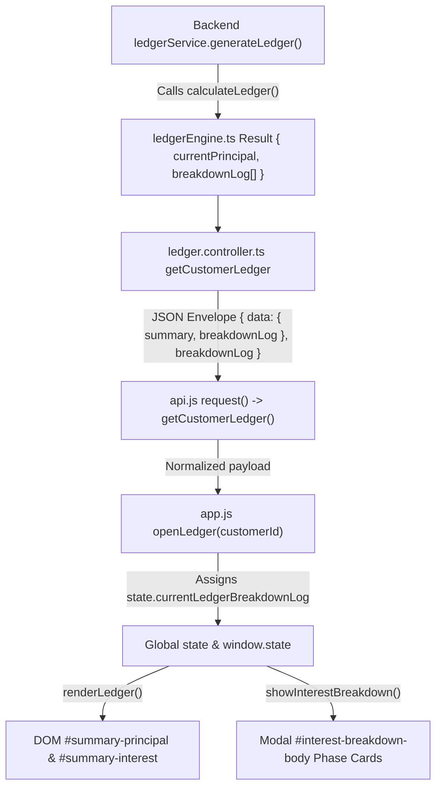

# Frontend Deep Analysis & Integration Map (`frontend_integration_map.md`)

## 1. Architectural System Overview

The Malwa Ledger Pro (Kirana Ledger) application follows a layered client-server architecture:
- **Presentation Layer (`index.html`, `style.css`)**: Vanilla HTML5/CSS3 single-page application with responsive layouts, modal dialogs, and summary stat cards.
- **State & Business Presentation Layer (`app.js`)**: Manages the global `state` store, view routing, user interaction handlers, calculation rendering, and UI/UX formatting.
- **Network & API Interceptor Layer (`api.js`)**: Encapsulates `BASE_URL`, JWT authentication tokens, 20-second timeout handling, automatic retry mechanisms, 401 logout interception, and request/response serialization.
- **Backend Service Layer (`backend/src/`)**: Node.js/Express TypeScript backend utilizing Prisma ORM over PostgreSQL, strict Zod validation, and the canonical immutable calculation engine in `ledgerEngine.ts`.

---

## 2. Comprehensive Frontend API Integration Matrix

| # | Function (`api.js`) | HTTP & Endpoint | Auth Required | Request Payload | Expected Backend Response Payload | Target Frontend State Variable | Target DOM Elements Updated |
|---|---|---|---|---|---|---|---|
| 1 | `loginUser(email, password)` | `POST /auth/login` | No | `{ email, password }` | `{ status: 'success', data: { token, user: { id, email, businessName } } }` | `state.isAuthenticated`, `localStorage(ml_pro_auth_token)` | `#auth-view` (hidden), `#app-wrapper` (active), `#user-display-name` |
| 2 | `registerUser(email, password, name, businessName)` | `POST /auth/register` | No | `{ email, password, name, businessName }` | `{ status: 'success', data: { token, user } }` | `state.isAuthenticated`, `localStorage(ml_pro_auth_token)` | `#auth-view` (hidden), `#app-wrapper` (active), `#user-display-name` |
| 3 | `getCustomers(params)` | `GET /customers` | Yes | Query: `?page=1&limit=50&search=...` | `{ status: 'success', data: Customer[] \| { customers: Customer[], pagination } }` | `state.customers`, `state.pagination` | `#customer-list-body`, `#stat-total-customers`, `#stat-total-lent` |
| 4 | `getCustomerById(id)` | `GET /customers/:id` | Yes | URL Param: `id` | `{ status: 'success', data: Customer }` | `state.customers` (updated/synced item) | `#ledger-customer-name`, `#ledger-customer-phone` |
| 5 | `searchCustomers(query, params)` | `GET /customers/search` | Yes | Query: `?q=...` | `{ status: 'success', data: Customer[] }` | `state.customers` (filtered cache) | `#customer-list-body`, `#search-results-count` |
| 6 | `createCustomer(data)` | `POST /customers` | Yes | `{ name, phoneNumber, lendingRate, depositRate, defaultInterestType, compoundingFrequency, customCompoundDays }` | `{ status: 'success', data: Customer }` | `state.customers.push(newCustomer)` | `#customer-list-body`, `#stat-total-customers`, `#customer-modal` (closed) |
| 7 | `updateCustomer(id, data)` | `PUT /customers/:id` | Yes | Customer fields to update | `{ status: 'success', data: Customer }` | `state.customers[index]` | `#customer-list-body`, `#ledger-customer-name`, `#customer-modal` |
| 8 | `deleteCustomer(id)` | `DELETE /customers/:id` | Yes | URL Param: `id` | `{ status: 'success', message: 'Customer deleted' }` | `state.customers` (filtered), `state.transactions` | `#customer-list-body`, switches to `dashboard-view` |
| 9 | `getTransactions(params)` | `GET /transactions` | Yes | Query: `?page=1&limit=100` | `{ status: 'success', data: Transaction[] \| { transactions: Transaction[] } }` | `state.transactions` | Dashboard metrics, Recent Transactions Feed |
| 10 | `getTransactionById(id)` | `GET /transactions/:id` | Yes | URL Param: `id` | `{ status: 'success', data: Transaction }` | `state.transactions` item | `#transaction-modal` form prefill |
| 11 | `createTransaction(data)` | `POST /transactions` | Yes | `{ customerId, type, amount, date, interestStartDate, interestPhases, remarks }` | `{ status: 'success', data: Transaction }` | `state.transactions.push(newTxn)` | `#ledger-table-body`, `#summary-principal`, `#summary-interest`, `#summary-net` |
| 12 | `updateTransaction(id, data)` | `PUT /transactions/:id` | Yes | Updated transaction fields | `{ status: 'success', data: Transaction }` | `state.transactions[index]` | `#ledger-table-body`, `#summary-principal`, `#summary-interest` |
| 13 | `deleteTransaction(id)` | `DELETE /transactions/:id` | Yes | URL Param: `id` | `{ status: 'success', message: 'Deleted' }` | `state.transactions` (filtered) | `#ledger-table-body`, `#summary-principal`, `#summary-net` |
| 14 | `voidTransaction(id)` | `POST /transactions/:id/void` | Yes | URL Param: `id` | `{ status: 'success', data: Transaction(isVoided: true) }` | `state.transactions[index].isVoid = true` | `#ledger-table-body` (strikethrough & badge), summary stats |
| 15 | **`getCustomerLedger(customerId, params)`** | `GET /customers/:customerId/ledger` | Yes | URL Param: `customerId`, Query: `?calculationDate=YYYY-MM-DD` | `{ status: 'success', data: { customer, summary: { totalMoneyLent, totalMoneyReceived, outstandingPrincipal, accruedInterest, totalDue, unallocatedCredit, breakdownLog }, entries, transactions, breakdownLog }, summary, breakdownLog }` | **`state.currentLedgerSummary`**, **`state.currentLedgerBreakdownLog`**, **`state.transactions`** | **`#summary-principal`** (Raw Principal), **`#summary-interest`** (Gross Interest + `(Paid)` badge), **`#summary-net`** (Net Outstanding), **`#interest-breakdown-body`** (Modal Phase Cards), **`#ledger-table-body`** |
| 16 | `getCustomerTransactions(customerId)` | `GET /customers/:customerId/transactions` | Yes | URL Param: `customerId` | `{ status: 'success', data: Transaction[] }` | `state.transactions` for customer | `#ledger-table-body` |
| 17 | `getGlobalLedger(params)` | `GET /ledger/global` | Yes | Query: `?asOfDate=...` | `{ status: 'success', data: { totalOutstanding, totalInterest, customerCount } }` | Dashboard summary state | `#stat-total-lent`, `#stat-total-interest`, `#stat-net-balance` |
| 18 | `getItems(params)` | `GET /items` | Yes | Query params | `{ status: 'success', data: Item[] }` | `state.items` | `#items-table-body`, stock summary cards |
| 19 | `createItem(data)` | `POST /items` | Yes | Item fields | `{ status: 'success', data: Item }` | `state.items.push()` | `#items-table-body`, `#item-modal` |
| 20 | `getBills(params)` | `GET /bills` | Yes | Query params | `{ status: 'success', data: Bill[] }` | `state.bills` | `#bills-table-body`, billing metrics |
| 21 | `createBill(data)` | `POST /bills` | Yes | `{ customerId, items, totalAmount, date }` | `{ status: 'success', data: Bill }` | `state.bills.push()`, `state.transactions.push()` | `#bills-table-body`, `#bill-modal` |
| 22 | `getCashbook(params)` | `GET /cashbook` | Yes | Query params | `{ status: 'success', data: CashbookEntry[] }` | `state.cashbook` | `#cashbook-table-body`, `#cashbook-balance` |
| 23 | `createCashbookEntry(data)` | `POST /cashbook` | Yes | `{ type, amount, category, remarks, date }` | `{ status: 'success', data: CashbookEntry }` | `state.cashbook.push()` | `#cashbook-table-body`, `#cashbook-balance` |
| 24 | `getInsurance()` | `GET /insurance` | Yes | None | `{ status: 'success', data: InsurancePolicy }` | `state.insurance` | `#insurance-policy-name`, `#insurance-expiry-badge` |
| 25 | `updateInsurance(data)` | `PUT /insurance` | Yes | Policy fields | `{ status: 'success', data: InsurancePolicy }` | `state.insurance` | `#insurance-details-container`, `#insurance-modal` |
| 26 | `getReportSummary(type)` | `GET /reports/summary` | Yes | Query: `?type=all` | `{ status: 'success', data: ReportMetrics }` | Report state cache | `#report-summary-cards`, `#tax-report-container` |

---

## 3. Data Flow & Point-of-Failure Breakdown

### The Data Propagation Chain

### Exact Points of Failure Identified and Resolved

1. **Frozen API Prototype**: `window.LedgerAPI` was wrapped in `Object.freeze(...)` in `api.js`. This caused mock assignments in test runners and integration suites (`window.LedgerAPI.getCustomerLedger = ...`) to fail silently in non-strict mode.
2. **Missing Global Window Binding**: `let state = {...}` was declared strictly in local script scope in `app.js` without assigning `window.state = state`. Any automation or Puppeteer audit checking `window.state.currentLedgerBreakdownLog` returned `undefined`.
3. **Envelope Unwrapping Vulnerability**: When `request()` in `api.js` returned `responseData.data`, callers checking `res.breakdownLog` directly failed if `breakdownLog` was only attached to root `responseData`.
4. **Post-Mutation Desynchronization**: When a transaction or settlement occurred in `transaction-form.onsubmit`, `syncStateFromBackend()` re-fetched `customers` and `transactions` and called `renderLedger()`, but failed to re-invoke `openLedger(customerId)`. This left `state.currentLedgerBreakdownLog` stale.
5. **Offline/Test Mode Fallback Deprivation**: When network errors, 401 unauthenticated states, or test-mode flags triggered `catch (err)` in `openLedger`, `state.currentLedgerBreakdownLog` was reset to `null` with no fallback computation, resulting in `#summary-interest` showing `₹0.00` and the modal throwing `"Backend breakdown data is missing or unavailable"`.
